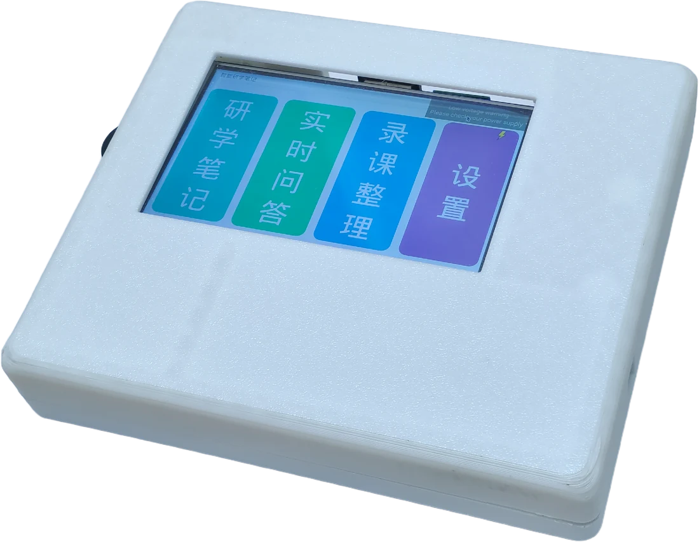
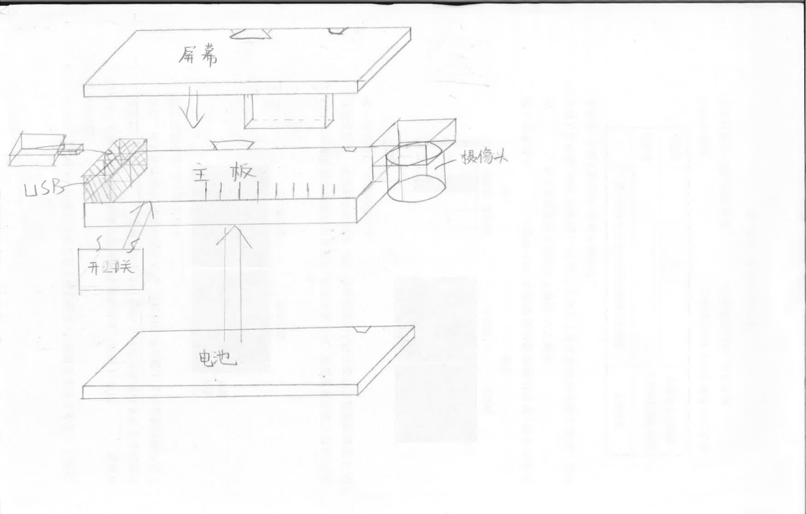
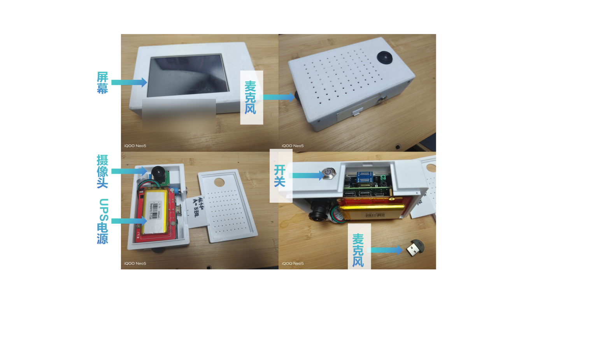
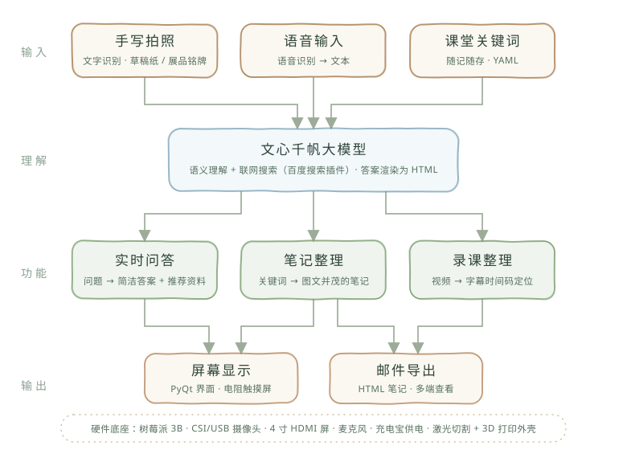
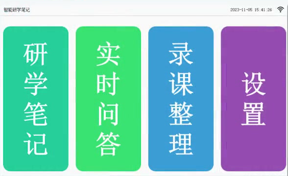
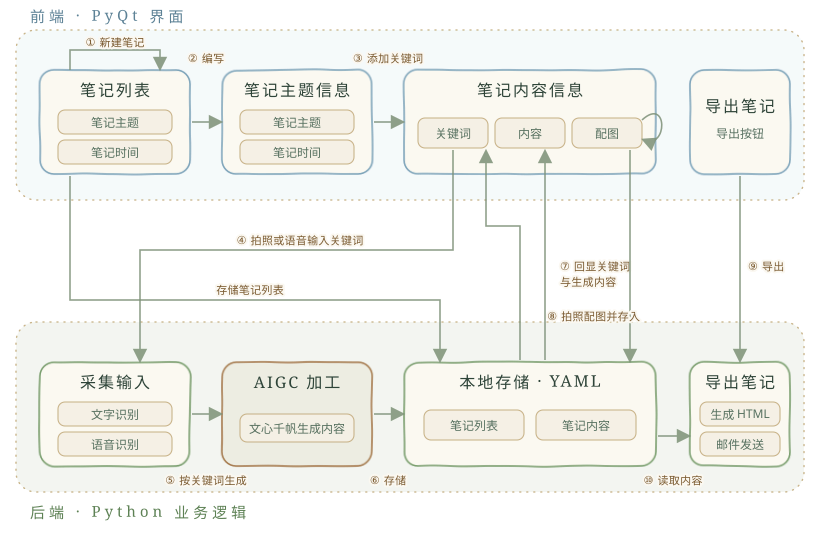

# 智能研学笔记 smart-notebook — 装进口袋的 AI 答疑学习机

> **一句话**：一台基于大模型的随身答疑学习机的完整软件——拍下展板讲义自动识别整理成带图笔记，对着麦克风提问语音作答，丢给它课程录像链接转写整理，一键邮件导出。
>
> The complete software of a pocket AI Q&A learning device: photograph a board or handout and it becomes an illustrated note via handwriting OCR + LLM; ask questions by photo or voice; scan a QR code holding a lecture-video URL to transcribe it and locate answers by timestamp; export notes by email.

2023–2024 年青少年科技创新赛事作品（获一等奖）。选题时恰逢 ChatGPT 面世：作者当时同时准备物理、生物竞赛，问题又多又冷门，而校内不许带手机——于是做了这台**随时答疑、把问题沉淀成知识库、并推荐延伸资料**的学习设备（这一思路与后来的 RAG、记忆机制不谋而合）。成品是硬件整机：树莓派 3B+ + 4 英寸触摸屏 + 摄像头 + 麦克风，3D 打印 / 激光切割外壳；**本仓库是它的全部软件**（PyQt5），在 Windows 电脑上也能直接运行。



| 手绘结构爆炸图 | 整机拆解（树莓派 3B+ · UPS 电源 · 摄像头 · 麦克风 · 开关） |
| --- | --- |
|  |  |

主界面四个入口，对应三条功能线，共用同一套「输入 → 大模型理解 → 输出」主干：



- **实时问答**：手写拍照 / 语音 → 文心千帆语义理解 → 简洁答案 + 推荐资料
- **笔记整理**：课堂关键词 → AI 补充资料 → 排版为图文 HTML 笔记
- **录课整理**：录课视频 → 转写生成时间码字幕 → 按主题 / 问题定位到视频时间点

AI 能力全部来自百度智能云（文心千帆 / 手写 OCR / 语音识别 / 录音转写），无本地模型。

---

## 目录

- [它能干什么](#它能干什么)
- [快速开始（15 分钟）](#快速开始15-分钟)
- [系统架构（一张图看懂）](#系统架构一张图看懂)
- [仓库结构](#仓库结构)
- [新手入门路线](#新手入门路线)
- [关键概念速查](#关键概念速查)
- [设计要点](#设计要点)
- [已知限制](#已知限制)
- [文档与代码规范](#文档与代码规范)
- [团队与致谢](#团队与致谢)
- [许可证](#许可证)

---

## 它能干什么



一位同学带着它去研学：站在展板前**拍一张照**，应用调手写 OCR 认出关键词（如「耳朵眼炸糕」），文心千帆流式生成讲解正文；点一下配图区再拍一张展品照片作为配图——几个关键词拍下来，一篇研学笔记就攒成了。



遇到不懂的，在草稿纸上写下问题拍照，或者点「开始录音」直接问，识别后大模型作答，回答逐字流式上屏，问答自动留档。回到教室，用摄像头扫一个内容为课程录像 mp4 链接的二维码，视频开始播放，同时云端转写成带时间戳的文稿——之后提问，大模型会在文稿里找出相关内容位于「18 分 32 秒」这样的时间点。最后**导出**，整篇笔记（HTML + 内嵌配图）从你的邮箱发到设置里的收件箱。

整台设备没有键盘：所有文字都靠拍照（手写 OCR）、录音（语音识别）或扫二维码录入，这是针对课堂不便说话、户外不便打字的场景做的设计。

答辩前实测：手写 OCR 对不同字体识别率约 **98%**，文言文生僻字、中英混排都能认。

## 快速开始（15 分钟）

1. Windows 10/11 + Python 3.9，仓库放**纯英文路径**
2. 右键 `script/install.ps1` →「使用 PowerShell 运行」（创建 venv 并装全部依赖）
3. 到[百度智能云](https://console.bce.baidu.com/)为 4 项服务各建一个应用，把 Key/Secret 设成环境变量（对照表与 setx 示例见 [`docs/getting-started.md`](docs/getting-started.md)）
4. 右键 `script/launch.ps1` 启动 → 主菜单「设置」里填收件邮箱 → 「研学笔记」新建第一篇笔记（需要摄像头；电脑自带摄像头即可）

十分钟全流程（拍照记笔记 → 语音问答 → 录课整理 → 邮件导出）与常见问题：[`docs/getting-started.md`](docs/getting-started.md)

## 系统架构（一张图看懂）

```
拍照/语音 ──> OCR.py / SpeechRecognize.py ──> 文字关键词
                 │
                 ▼  WenxinNote（文心千帆）：流式生成讲解 HTML
case.yaml <── function.py（业务中枢：笔记/课程/关键词/问答 增删查）
   │  │
   │  └─ 邮件导出：mailUtils.py（SMTP，HTML 内嵌配图）
   │
   ├─ 问答：OCR / SpeechRecognize → WenxinQa → qa_history_list
   └─ 录课：扫码得 URL → AudioTranscriptionCreate（建任务）
            → 点「提问」时 AudioTranscriptionCheck（查任务，完成则存文稿到 course_case）
            → WenxinCourse（按问题在文稿里定位时间点）
```

模块职责、数据流与 `case.yaml` 结构：[`docs/architecture.md`](docs/architecture.md)

## 仓库结构

```
smartnotebook/                  应用包（内含包级 README：分层地图与调用链）
  main.py / app.py              入口与 QApplication（script/launch.ps1 以 python smartnotebook\main.py 启动）
  ui/                           前端：界面层，按功能页成对
    mainui.py                   主菜单（研学笔记/实时问答/录课整理/设置）
    *ui.py / *uic.py            各界面布局（Qt Designer 导出）与事件逻辑
  core/                         后端：业务与数据
    function.py                 业务中枢：case.yaml 读写、数据管理、流程串联
  services/                     后端：外部服务封装
    OCR.py / SpeechRecognize.py / AudioTranscription*.py   百度 AI（手写识别/语音识别/录音转写）
    Wenxin*.py                  文心千帆对话封装（单轮/笔记/课程/问答/流程）
    mailUtils.py / wifiUtils.py SMTP 邮件导出 / 联网检测
  assets/                       界面图标与占位图（wifi / loading / 占位图等）
data/                           全部业务数据：case.yaml（六键）+ img/（运行时配图）
script/                         install.ps1（建环境）/ launch.ps1（启动，自动锚定仓库根）
requirements.txt                依赖清单（install.ps1 读取）
docs/                           getting-started / architecture / assets（架构图、硬件图）
```

## 新手入门路线

**第 1 步：跑起来** — 本 README「快速开始」+ [`docs/getting-started.md`](docs/getting-started.md) 的密钥配置节（**没有密钥跑不动**，这是唯一的门槛）。

**第 2 步：走通三条主流程** — 同文档「十分钟走通全流程」：研学笔记（拍照）、实时问答（语音）、录课整理（URL），最后邮件导出。

**第 3 步：理解数据** — 读 [`docs/architecture.md`](docs/architecture.md)：六个顶层键的 schema、三条数据流、数据统一在 `data/` 目录（`case.yaml` + `img/`），整个目录备份即全量备份。

**第 4 步：想改代码 / 二次开发** — 各手写模块旁有 `.doc.md`（中英双语）；从 `core/function.py` 入手最直观，换大模型看 `services/WenxinSingle.py`，界面逻辑在 `ui/`。

## 关键概念速查

| 术语 | 含义 |
| --- | --- |
| 笔记（note） | 研学笔记的基本单元，编号 `num`，含多个关键词条目 |
| 关键词条目 | `{keyword, content, img}`：关键词 + 生成的 HTML 正文 + 配图路径 |
| 课程（course） | 录课整理单元：`{doc, task_id, url}`，文稿/转写任务号/视频直链 |
| 问答历史 | `{question, QandA_html, date, num}`，问答双部分渲染后的 HTML |
| data/ | 唯一数据目录：`case.yaml`（六键）+ `img/` 配图，整个目录备份即全量备份 |
| 环境变量 | 5 组凭据全部 `os.environ` 读取，代码内无密钥（表见 getting-started） |

## 设计要点

给想做类似项目的同学，下面每条都能在代码里找到对应位置：

- **先定输入方式，再写功能**：课堂上不便说话、打字太慢，所以以手写拍照 OCR 为主、语音为辅；WiFi 密码这类含特殊字符的设置项改用扫二维码录入，省掉难做又难用的软键盘（`ui/*inputuic.py`）
- **算力全部上云**：树莓派跑不动大模型，OCR / 语音识别 / 录音转写 / 大模型都调百度智能云 REST 接口，设备只管采集、界面和存储；每个接口一个文件，换供应商只动 `services/`
- **流式输出减少等待**：大模型回答用 aiohttp 流式读取，pyee 事件逐段推给界面，生成一句显示一句（`services/Wenxin*.py`）
- **一个模型，按场景拆提示词**：问答、笔记扩写、录课时间定位三套 prompt 集中在 `core/function.py`
- **防依赖，不做搜题机**：问题超过 50 字直接拒绝，问答 prompt 要求模型对明显的考试题拒答（`core/function.get_question_*`）
- **数据就是一个 YAML**：不用数据库，`data/case.yaml` + 配图目录，打开就能看、复制就能备份
- **布局与逻辑分文件**：每个页面先在纸上画清控件、跳转和要读写的字段，再拆成 `*ui.py`（Qt Designer 布局）和 `*uic.py`（事件逻辑）

## 已知限制

- AI 能力依赖百度智能云 API 与网络，免费额度有限（超量报 error 17）
- 大模型调用按 2023–2024 年的千帆 v1 接口（`wenxinworkshop/chat/completions`）编写；百度之后推出了 v2 接口并陆续下线旧模型，若大模型调用报错，需按现行千帆文档修改 `services/Wenxin*.py` 的请求地址与鉴权方式
- 不支持连续追问；录课提问会把整份转写文稿放进一次 prompt，长视频会超出模型输入长度
- 语音识别对环境噪声敏感；手写 OCR 依赖拍摄质量，数学公式与符号基本识别不了
- 邮件导出目前内置 163 SMTP（SSL 465），其他邮箱需改 `mailUtils.py`
- 安装 / 启动脚本只提供 Windows PowerShell 版；原设备运行在树莓派 3B+（Raspberry Pi OS）上，Linux 下可手动 `pip install -r requirements.txt`，再在仓库根执行 `python smartnotebook/main.py`

## 文档与代码规范

- 每个手写代码文件旁配 `<文件名>.doc.md`（中英双语，先中后英）：职责、关键函数、坑点
- `*ui.py`（Qt Designer 导出的布局代码）不逐个配文档，布局与逻辑的对应关系见 `docs/architecture.md` 的命名规律一节
- 流程/迭代类过程文档不放入本仓库
- 凭据一律环境变量（命名见 getting-started），任何文件不得出现硬编码密钥

## 团队与致谢

北京市昌平区第二中学作品（2023–2024）。

| 成员 | 分工 |
| --- | --- |
| 程千和（水烛 / typha） | 课题提出、软件与架构、迭代主导 |
| 邱家承 | 硬件：3D 打印外形、供电结构 |
| 李韶芸 | 问卷调查、答辩与对外 |
| 张佳一 | 参加全国青年科普创新实验暨作品大赛时加入 |

指导教师：杨静、王继飞、田俊欣。感谢昌平二中机器人社团，以及参与调研和试用的同学与老师。

演示视频、硬件迭代过程与研究报告见[项目展示页](https://profile.typha.top/exp/notebook.html)。

## 许可证

[MIT](LICENSE)
